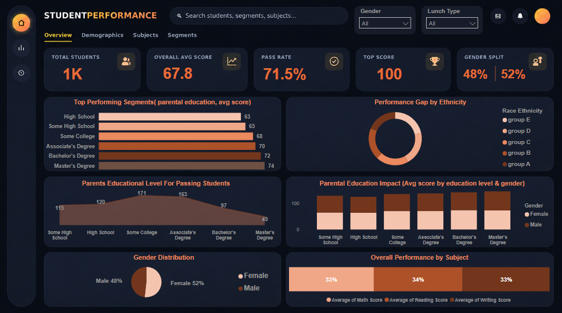
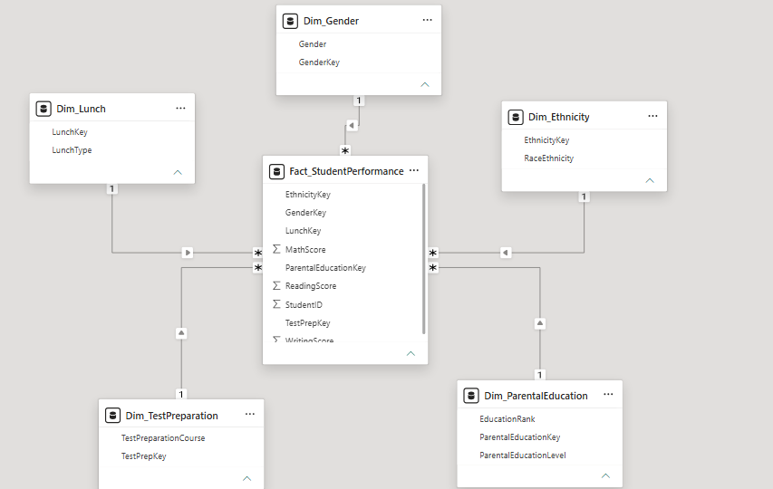

# Student Performance Analytics — Power BI Dashboard

> Numbers don't earn trust. Models do.

An interactive Power BI dashboard analyzing academic performance across 1,000 students, exploring how gender, ethnicity, parental education, lunch type, and test preparation relate to outcomes in Math, Reading, and Writing.



---

## 📌 Business Problem

Educational institutions need to understand **where performance gaps come from** before they can act on them. This dashboard was built to answer four core questions (assignment brief) plus additional analytical depth:

1. What is the overall performance level across the student body?
2. How does performance differ between male and female students?
3. Is there a measurable performance gap across ethnic groups?
4. Does parental education level influence student outcomes?

Additional questions explored beyond the brief: Which specific student segments (ethnicity × parental education) perform best? How is performance distributed across score ranges per subject? Does test preparation or lunch type (a socioeconomic proxy) correlate with outcomes?

---

## 🔑 Key Insights

| Metric | Value |
|---|---|
| Total students analyzed | 1,000 |
| Overall average score (Math/Reading/Writing) | 67.8 / 100 |
| Pass rate (≥60 overall average) | 71.5% |
| Highest individual overall score | 100.0 |
| Gender split | 51.8% Female · 48.2% Male |
| Gender performance gap | Female 69.6 vs Male 65.8 (+3.8 pts) |
| Ethnicity performance gap | Group E 72.8 vs Group A 63.0 (+9.8 pts) |
| Parental education uplift | Master's households +8.5 pts vs Some High School |
| Top performing segment | Group D × Master's degree parents — avg 76.5 (n=23) |

---

## 🗂️ Data Model — Star Schema



The dataset was restructured from a single flat file into a **Star Schema**: one fact table surrounded by five single-level dimension tables.

**`Fact_StudentPerformance`** — grain: one row per student
- `StudentID` (surrogate key)
- `GenderKey`, `EthnicityKey`, `ParentalEducationKey`, `LunchKey`, `TestPrepKey` (foreign keys)
- `MathScore`, `ReadingScore`, `WritingScore`

**Dimensions:** `Dim_Gender`, `Dim_Ethnicity`, `Dim_ParentalEducation` (includes an `EducationRank` column for correct ordinal sorting), `Dim_Lunch`, `Dim_TestPreparation`

**Why a Star Schema on a dataset this size?** Technically, a single flat table would perform identically here — cardinality on every categorical column is low (2–6 distinct values) and VertiPaq compresses either layout equally well. The Star Schema was chosen deliberately as a **modeling best practice** (clean relationships, correct sort order via `EducationRank`, reusable dimensions) rather than a performance necessity, which matters more as the dataset or number of fact tables grows.

---

## 📊 Visuals

| Visual | Type | Insight |
|---|---|---|
| Overall Performance by Subject | Bar Chart | Compares average Math/Reading/Writing scores |
| Gender Distribution | Pie Chart | Male vs Female share of the student body |
| Performance Gap by Ethnicity | Donut Chart | Average score per ethnic group, highlighting the spread |
| Parental Education Impact | Stacked Bar Chart | Average score by parental education level, split by gender |
| Top Performing Segments | Bar Chart | Best-performing ethnicity × parental education combinations (min. 10 students) |
| Score Distribution | Chart | Student count per score band, per subject |

**Interactivity:** Gender and Test Preparation slicers, with cross-filtering enabled across all visuals.

---

## 🧮 DAX Highlights

```dax
Overall Avg Score =
AVERAGEX(
    Fact_StudentPerformance,
    (Fact_StudentPerformance[MathScore] + Fact_StudentPerformance[ReadingScore] + Fact_StudentPerformance[WritingScore]) / 3
)

Pass Rate = DIVIDE([Passing Students], [Total Students])

Ethnicity Performance Gap = [Highest Performing Ethnicity Score] - [Lowest Performing Ethnicity Score]

Education Score Uplift = [Avg Score - Highest Education (Master's)] - [Avg Score - Lowest Education (Some High School)]
```

29 measures total, covering KPI cards, subject averages, ethnicity ranking, parental education impact, and score-band distribution.

---

## 🛠️ Tech Stack
- **Power BI Desktop** — data modeling, DAX, visualization
- **Power Query** — data shaping (Star Schema build-out from the original flat file)
- **Excel** — source dataset

---

## 🔧 Known Limitations & Next Steps

In the interest of transparent documentation, a few refinements are planned for the next iteration:
- The **Overall Performance by Subject** visual is currently rendered as a 100% stacked bar, which compresses the three subjects into near-equal percentages and hides the real point differences (66.1 / 69.2 / 68.1). Switching to a standard clustered column chart (0–100 axis) will show the actual gap.
- The color palette across the Ethnicity donut, Education stacked bar, and Segments chart currently uses close shades of the same hue, making categories harder to distinguish at a glance — a wider, more distinct palette is planned.
- The slicer dropdowns currently use the default light theme styling rather than matching the dashboard's dark background.

---

## 📁 Repository Structure
```
student-performance-bi-dashboard/
├── Students_Performance_Dashboard.pbix
├── data/
│   └── Students_Performance_Dataset.xlsx
├── screenshots/
│   ├── dashboard_overview.png
│   └── data_model.png
└── README.md
```

## 🚀 How to Explore
1. Clone or download this repository
2. Open `Students_Performance_Dashboard.pbix` in Power BI Desktop
3. Use the Gender / Test Preparation slicers to filter the dashboard
4. Click any segment in the Ethnicity donut or Education chart to cross-filter the rest of the page

---

## 📬 Contact

Built by **Ahmed Elsayed** — Data Analyst & BI Developer, open to remote BI Developer / Data Analyst roles.
Feel free to connect or reach out for freelance/full-time opportunities.
